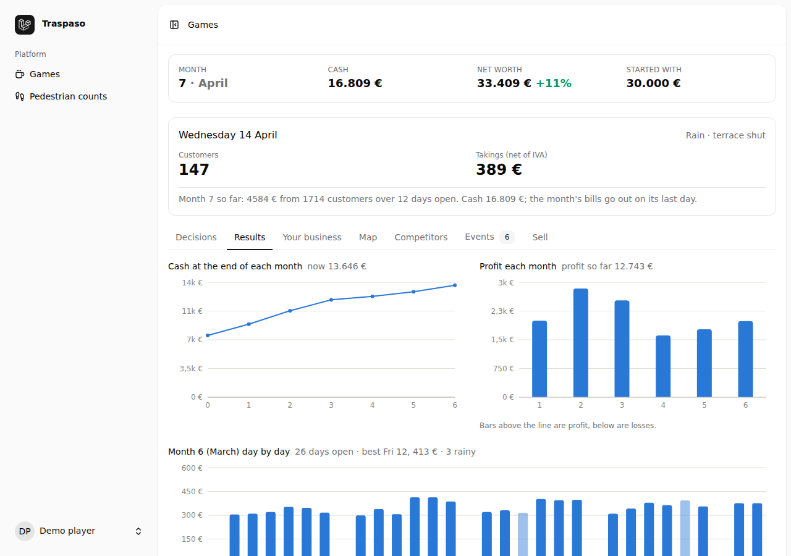
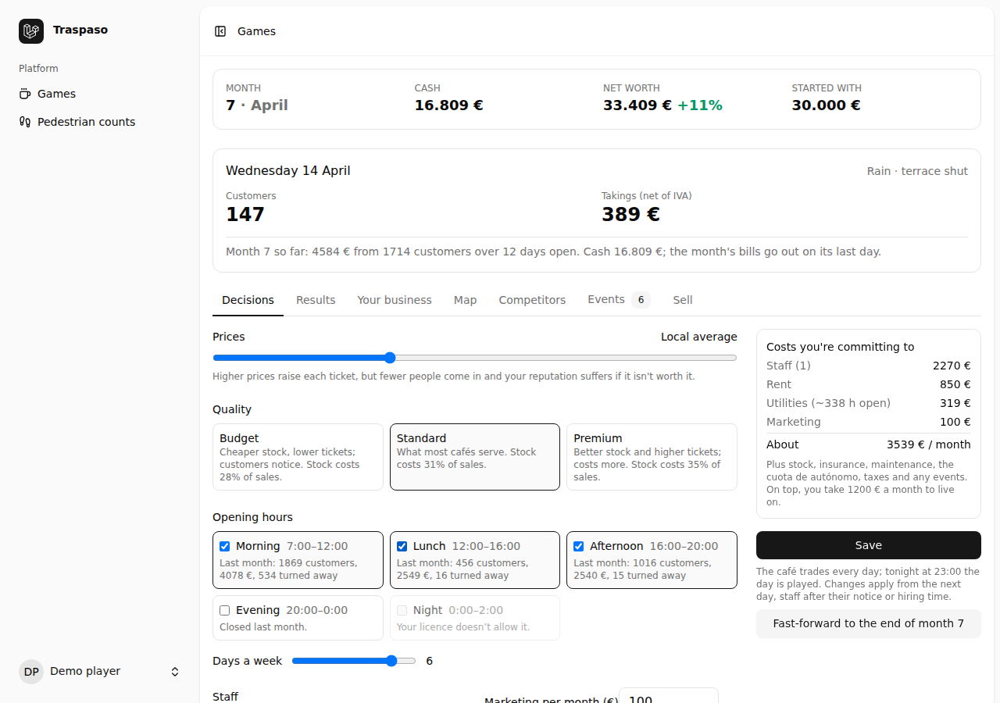

# Traspaso

A simulation of running a café in Zaragoza: take over a business through a
*traspaso* (buying the lease, fit-out and goodwill of a going concern), run
it day by day in real time, and sell up or close when it's time. It's built
to be realistic rather than fun: the economy is calibrated to real closure
rates, sourced wages and taxes, and aggregated listing prices, and every
number says where it comes from.

> Business locations, financial data and operating characteristics are
> simulated. Real-world market data is used to establish realistic ranges
> and distributions.



## What it does

- **The game.** Choose a café from a generated market of 100–200 listings
  placed on real Zaragoza commercial streets, with real cafés and bars
  nearby as rivals. Set prices, quality, opening hours, staff and
  marketing. One game day passes per real day: every night at 23:00 the
  server plays the day (weather, weekdays, holidays, the Pilar week,
  events) and sends a push notification with the results. Rent, wages and
  your own pay go out at the month end; run out of cash and it's over.
- **Selling and buying.** List the café privately or through an agency and
  wait for buyers (who value it on its last year's accounts), negotiate,
  pay the gestoría and income tax on the gain, or close it down or sell it
  fast. Then buy another with what's left.
- **The viability check.** Pin a real café on the map, enter the listing's
  figures and how you'd run it, and get 1,000 simulated five-year futures:
  survival at 1, 3 and 5 years, profit ranges, when the traspaso is earned
  back, what it would sell for, and the risks.
- **An installable app**, with Stripe payments for the full viability report
  and for bigger starting capital.



## Realism first

- **Calibrated to outcomes.** `php artisan market:balance` plays thousands of
  complete games with scripted strategies (a typical owner, a thoughtful
  one, a careless one, a flipper…) and checks targets from real data: 20–25%
  of new cafés and bars close within a year and about half survive five
  (INE/DIRCE); a café run as the seller ran it resells for a little under its
  asking price; buying and selling cafés is no money machine.
- **Sourced inputs.** Wages from the Zaragoza hostelería collective
  agreement, Social Security and self-employed contributions, IVA and IRPF,
  deposit and severance rules from Spanish law, opening hours from the city
  ordinance, rents and traspaso prices from aggregated listings (never
  single listings).
- **Honest about the gaps.** Every section of the parameter sheet is marked
  real, fitted, guess or game design, and a sensitivity table shows which
  guesses actually move the results (see
  [docs/balance-report.md](docs/balance-report.md)).
- **Footfall from open data.** Pedestrian footfall for every commercial
  street point is estimated offline from OpenStreetMap (shops and services
  nearby, street centrality, population, transport stops), per time of day,
  and calibrated against manual counts made with the app's counting page.

## How it's built

- **Laravel 13**, **Inertia + React + TypeScript**, **Tailwind**, **SQLite**,
  **Pest** (750+ tests), Leaflet with OpenStreetMap tiles.
- **A pure simulation engine** in `app/Simulation/`: plain PHP with no
  framework, database or clock, everything passed in as immutable DTOs and
  all randomness from a seeded generator, so any game or simulation replays
  exactly. A monthly engine and a day-by-day engine share the same steps.
- **One parameter sheet** (`config/market/zaragoza_cafe.php`) holds every
  economic number with its source; nothing economic is hard-coded.
- **Real time on the server:** a scheduled nightly job queues each café's
  day; days are played once, in order, with catch-up after a missed night.
  Web Push (VAPID) notifications, a service worker and a web app manifest.
- **Production basics:** health checks, backups, a deployment guide for a
  small EU server, and GDPR data export and deletion
  ([docs/deploy.md](docs/deploy.md)).

The design, scope and milestones are in [SPEC.md](SPEC.md).

## Running it locally

You need PHP 8.3+ (with the `sqlite3`, `pdo_sqlite`, `mbstring` and `intl`
extensions), Composer and Node 22.

```bash
git clone <this repo> traspaso && cd traspaso
composer setup      # installs, creates the SQLite database, migrates, loads the geo data, builds the frontend
composer dev        # serves the app at http://localhost:8000 (plus Vite and the queue)
```

Open http://localhost:8000, register an account, and click **Games** to
start one. Email verification is required: in local development the
verification email goes to the log (`storage/logs/laravel.log`); copy the
link from there. Or create a verified user straight away:

```bash
php artisan tinker --execute="App\Models\User::factory()->create(['email' => 'me@example.com']);"
# then log in as me@example.com with the password: password
```

### On Windows

- Use a PHP build with a `php.ini`: copy `php.ini-development` to `php.ini`
  in the PHP folder and enable `extension=curl`, `fileinfo`, `intl`,
  `mbstring`, `openssl`, `pdo_sqlite`, `sqlite3` and `zip`.
- For `php artisan geo:fetch` (or anything else that downloads over HTTPS),
  PHP needs trusted certificate authorities: download
  https://curl.se/ca/cacert.pem and set `curl.cainfo` and `openssl.cafile`
  in `php.ini` to its full path.
- If `composer dev` fails (its log viewer needs a Unix-only extension), run
  `php artisan serve` instead. `composer setup` has already built the
  frontend, so that's all you need.

## Useful commands

```bash
php artisan test                 # the whole test suite (Pest)
php artisan market:placeholders  # which market parameters still need real research
php artisan market:balance       # play 1,000 games per scripted strategy and report how they end
php artisan market:balance --years=5   # the same over five years, with a survival curve
```

`market:balance` plays on whatever geo data is seeded; see
`docs/balance-report.md` for the latest results and what they led to.

## The viability check

`/viability` (no account needed): pin a café on the map, enter the listing's
figures, and it runs 1,000 simulated five-year futures on the queue (about half
a minute; keep `php artisan queue:work` running). The full report is meant to
be paid for; for local testing put `VIABILITY_UNLOCK_ALL=true` in `.env`.

## Going live

`docs/deploy.md` covers running it on a server: the configs in `deploy/`,
the production `.env`, monitoring (`/up`, `php artisan app:health`), nightly
backups (`php artisan app:backup`) and the GDPR basics.

## Payments

The full viability report and the bigger capital tiers are paid for with
Stripe Checkout (prices in `config/payments.php`). Put the keys in `.env`:

```bash
STRIPE_SECRET=sk_test_...
STRIPE_WEBHOOK_SECRET=whsec_...   # from the webhook endpoint, or `stripe listen`
STRIPE_TAX_RATE_ID=txr_...        # optional: an inclusive 21% IVA rate, shown on receipts
```

The webhook endpoint is `/stripe/webhook` (events `checkout.session.completed`
and `checkout.session.async_payment_succeeded`). Locally, forward it with
`stripe listen --forward-to localhost:8000/stripe/webhook`; a card payment is
also confirmed when the buyer returns from Checkout, so the webhook isn't
needed for a quick test (card `4242 4242 4242 4242`). Without keys nothing can
be bought and the rest works as before.

## Push notifications and the app

The game can be installed as an app (Settings → Notifications → Install, or
the browser's "Add to Home Screen") and sends each night's results as a push
notification. Push needs a key pair, generated once:

```bash
php artisan webpush:vapid   # prints WEBPUSH_PUBLIC_KEY / WEBPUSH_PRIVATE_KEY / WEBPUSH_SUBJECT for .env
```

Then turn notifications on for each device in Settings → Notifications.
Browsers only allow push on HTTPS or `localhost`; on iPhone the app must be
added to the home screen first. Without keys the game works but sends nothing.

## Map and real geo data

The map uses OpenStreetMap tiles, loaded by your browser
(© OpenStreetMap contributors).

Out of the box, neighbourhood areas, landmarks and business positions are
approximate placeholders. To build the real data (district boundaries,
points of interest and the footfall surface) from OpenStreetMap, on a
machine with internet access:

```bash
php artisan geo:fetch    # downloads OSM data for the city (a few minutes)
php artisan geo:build    # derives the files in database/seeders/geo/zaragoza (a minute or two)
php artisan db:seed --class=NeighbourhoodSeeder
php artisan db:seed --class=PointOfInterestSeeder
php artisan db:seed --class=FootfallPointSeeder
```

Then start a new game. Fill in `database/seeders/geo/zaragoza/sources/population.csv`
with real district populations before building, and see
[database/seeders/geo/zaragoza/README.md](database/seeders/geo/zaragoza/README.md)
for calibrating footfall against your own pedestrian counts.
